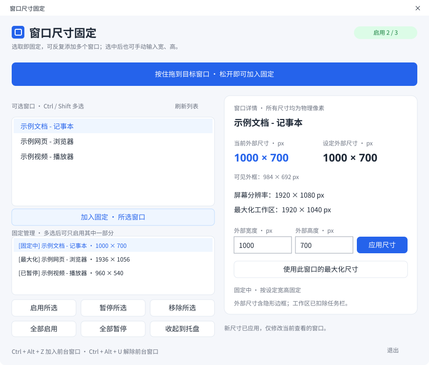

# 窗口尺寸固定 · Window Size Lock

把目标窗口调整到喜欢的大小，按住蓝色按钮拖到目标窗口，松开即可固定。程序自动记录宽、高；之后放大、缩小或最大化，会自动恢复到记录的尺寸。

**Windows 10 / 11 · 原生 C++ / Win32 · 单个 EXE · 无需安装 · MIT 开源**

[下载最新便携版](https://github.com/hujianj/window-size-lock/releases/latest) · [验证记录](docs/VALIDATION.md) · [更新记录](CHANGELOG.md)



上图为新版界面示意，窗口名为模拟数据；程序界面已在 Windows 11 的真实窗口上检查。

## 三步使用

1. 下载 Release 中的 `WindowSizeLock.exe`，或下载 ZIP 并解压，然后双击运行。
2. 把目标窗口还原并调整到想要的大小。
3. 按住蓝色选取按钮，拖到目标窗口上松开。也可以双击窗口列表，或选中后点击“固定选中窗口”。

固定尺寸和当前尺寸会分别显示在上方卡片。窗口仍可自由移动；最小化时暂停，还原后继续固定；最大化会自动还原。

- **解除固定**：点击按钮，或按 `Ctrl + Alt + U`。
- **固定前台窗口**：在目标窗口按 `Ctrl + Alt + Z`。
- **收起到托盘**：继续在后台固定。点击托盘图标，或再次运行 EXE，可重新显示面板。
- **退出**：解除控制并退出。右上角关闭按钮同样会退出。
- **刷新列表**：新打开的窗口没有出现在列表中时，点击“刷新列表”。

当前只固定一个窗口。选择新窗口会切换目标；目标关闭后自动解除。程序退出后不保留固定记录，下次运行重新选取即可。

## 为什么轻量

界面使用 Windows 原生控件与 GDI 绘制，没有 Electron、WebView、.NET 或 Python 运行依赖。采用静态 C++ 运行库，v1.1.0 x64 EXE 为 **164,864 字节（161 KiB）**。

恢复使用 WinEvent 事件通知，配合 1 秒定时检查作为兜底；常规纠正尝试间隔约 60 毫秒，持续冲突时降低到 500 毫秒，避免无限高频重试。后台收起、目标静止的本机 20 秒采样结果见[验证记录](docs/VALIDATION.md)，不能代表所有电脑和所有使用状态。

## 兼容范围

- 面向 Windows 10 / 11；提供 x64 下载。当前实测系统为 Windows 11 LTSC x64，**Windows 10 尚未真机验证**。
- 记录的是 `GetWindowRect` 返回的外部窗口宽、高，单位为物理像素，包含 Windows 的窗口边框。
- 支持允许外部改变窗口大小的普通桌面窗口。独占全屏游戏、受保护窗口、部分自绘窗口以及有尺寸下限的程序可能无法完全恢复。
- 权限需与目标匹配。普通权限程序通常无法控制以管理员权限运行的目标；必要时以相同权限重新运行并选取。
- 多显示器 DPI 切换可能触发目标程序自己的布局规则；跨屏行为尚未逐项实测。
- 快捷键若被占用，界面会提示，仍可使用拖动或列表。

## 从源码构建

安装 Visual Studio 2022 / Build Tools，勾选“使用 C++ 的桌面开发”和 Windows 10/11 SDK。在仓库根目录运行：

```powershell
powershell -NoProfile -ExecutionPolicy Bypass -File .\src\build.ps1
```

生成文件在 `src/bin/WindowSizeLock.exe`。脚本使用 MSVC `/O1 /MT /W4` 编译，默认 x64；自定义目录可传 `-OutDir`。GitHub Actions 会编译并上传构建产物，CI 编译不等同于桌面交互验证。

## 数据与许可

正常运行不创建配置或日志文件，不读取目标文档内容，不联网，不修改目标程序文件，不安装驱动或服务。窗口标题和尺寸仅用于本地界面显示。源码保留 `.diagnostics` 标记文件启用本地验证日志的开发入口，发布包不包含该标记。

本项目为独立编写的实现，采用 [MIT License](LICENSE)。

## English

A tiny native Windows utility that captures the current outer size of a selected window and restores it after resizing or maximizing. Drag the blue picker onto a window, double-click its list entry, or press `Ctrl + Alt + Z` in the target. Moving is allowed; minimizing pauses enforcement. Portable, one target at a time, no installation or external runtime required. Windows 11 x64 tested; Windows 10 is intended but not yet tested on a physical system.
